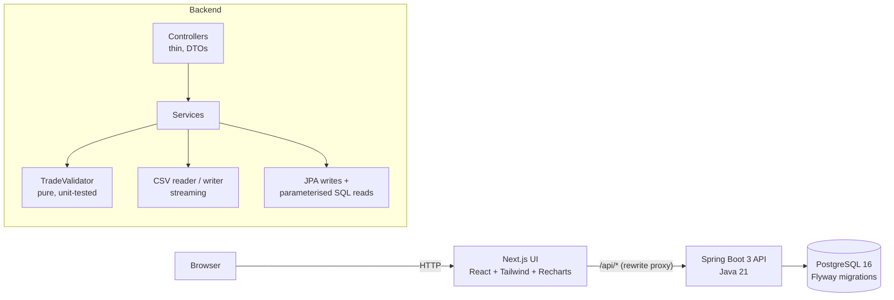
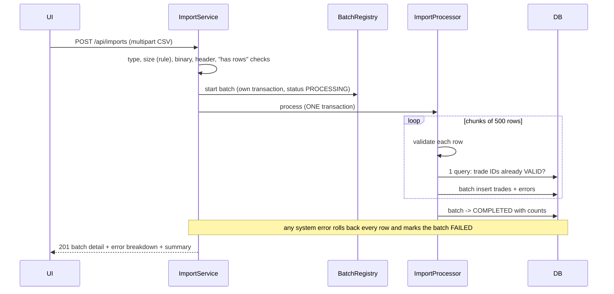
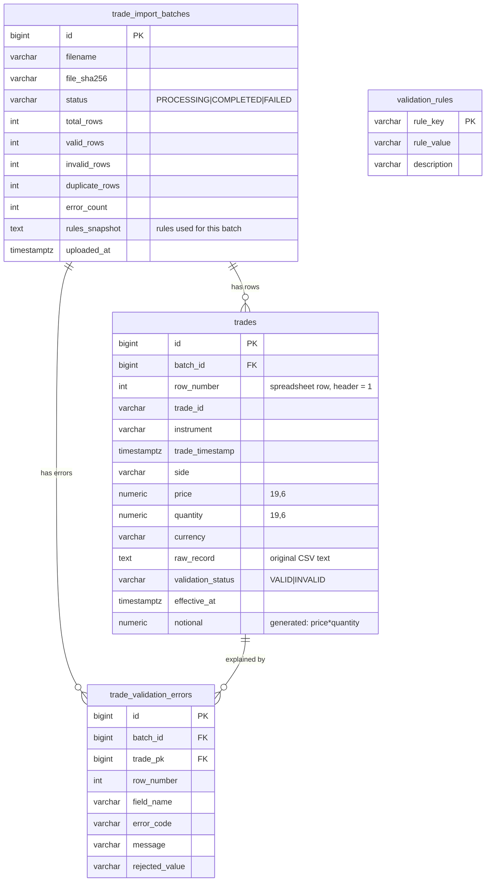

# TradeGuard — trading data quality & analytics

TradeGuard ingests trade files (CSV), validates every row, keeps a full audit trail of what was accepted and
rejected, and reports on the **valid** data with SQL analytics. It is a portfolio project that mirrors the kind of
internal tooling found around trading and derivatives platforms: data-quality checks, admin controls, reporting.

> **Disclaimer.** TradeGuard is a personal portfolio project. It uses **synthetic data only**, does not connect to any
> brokerage, exchange or market-data feed, does not execute trades, and is **not affiliated with, endorsed by, or
> built on the systems of any exchange or company** (including CME Group). Instrument symbols in the sample data are
> illustrative, and the prices are randomly generated.

## Business problem

Trade files arrive from many sources (execution systems, partners, spreadsheets). Bad rows — missing IDs, negative
prices, malformed timestamps, duplicate trade IDs — silently corrupt downstream reports. Operations teams need to:

1. **reject bad data early**, with an exact reason and the original row number;
2. **never lose** what was rejected (auditability, re-submission);
3. **keep analytics clean** — bad rows must not reach a number on a dashboard;
4. **adjust thresholds** (allowed currencies, size limits) without a code change; and
5. **export** results to spreadsheets without introducing new problems (CSV escaping, formula injection).

### Why this matters in financial software

A duplicated or mis-scaled trade changes volume, exposure and fee calculations. Money-like values need exact decimal
arithmetic (no floating point), timestamps need explicit time zones, and every rejection must be explainable after
the fact. TradeGuard is built around those constraints.

## Key features

| Area | What it does |
| --- | --- |
| **Import** | Drag-and-drop CSV upload, type/size checks, header checks, streaming parser, per-row validation, upload progress, batch summary, downloadable reports. |
| **Validation engine** | 21 error codes (missing / format / unsupported / range / duplicate / malformed row) with CSV row number, field, code and a human-readable explanation. |
| **Duplicate policy** | First valid occurrence of a trade ID wins; later copies (same file or earlier batch) are rejected, never overwritten. |
| **Trade explorer** | Server-side search, filters (date, instrument, side, status, batch), sorting, pagination; inspect any row and see its errors and original CSV text. |
| **Analytics** | Totals, per-currency notional, daily volume with running total (SQL window function), instrument and side breakdowns, error distribution, batch quality. |
| **Import history** | Every batch with status, counts, error rate; drill into the batch's errors. |
| **Rules** | Max upload size, allowed currencies, allowed instruments, max quantity — validated server-side, snapshotted per batch. |
| **Reports** | Valid trades, invalid rows + errors, batch summary (CSV) — same filters as the screen, RFC 4180 escaping, formula-injection protection. |
| **Plain-English summary** | Deterministic, rule-based explanation of a batch ("5 rows: trade ID repeats an earlier row…"). No LLM, no API key needed. |

## Architecture





Synchronous processing keeps the MVP simple. `ImportProcessor.process(batchId, reader, rules)` is the seam for
asynchronous processing: a queue worker can call it unchanged, and the `PROCESSING` / `COMPLETED` / `FAILED` status
column already models the lifecycle.

### Technology choices

| Technology | Why |
| --- | --- |
| **Java 21 + Spring Boot 3.5** | The target stack. Records for DTOs, `BigDecimal` money, Bean Validation, Actuator health. |
| **Spring Data JPA** for writes, **`NamedParameterJdbcTemplate`** for reads | JPA for entities/batch inserts; hand-written, parameterised SQL where aggregation matters (`GROUP BY`, `FILTER`, window functions, joins). One `TradeFilter` builds the `WHERE` clause for explorer, analytics and reports so they can never disagree. |
| **PostgreSQL 16 + Flyway** | Real constraints (CHECK, partial unique index, generated column), versioned migrations. |
| **Apache Commons CSV** | Correct quoting/escaping rules, streaming iterator (the one extra runtime dependency; hand-rolled CSV parsing is a classic bug source). |
| **Next.js 15 + TypeScript + Tailwind 3** | Typed UI; the Next rewrite proxies `/api/*` so the browser only talks to one origin. |
| **Recharts** | Charts from real API data. |
| **JUnit 5 + Testcontainers** | Integration tests run against a real PostgreSQL, not an in-memory fake. |
| **Playwright** | End-to-end tests of the real UI → API → DB path. |
| **Docker Compose** | One command to run db + API + UI. No Kubernetes/Kafka/Redis: not needed for this scope. |

## Database design



Migrations: [`V1__core_schema.sql`](backend/src/main/resources/db/migration/V1__core_schema.sql) (schema, constraints,
indexes) and [`V2__default_rules.sql`](backend/src/main/resources/db/migration/V2__default_rules.sql) (default rules).

**Decision: one `trades` table with a status, not a separate staging table.** Rejected rows must stay inspectable next
to their batch, and the explorer must be able to show valid and invalid rows together, so every uploaded row is stored.
Contamination of analytics is prevented in three layers instead:

1. every analytics/report query is restricted to `validation_status = 'VALID'`;
2. a `CHECK` constraint makes it impossible for a `VALID` row to have a missing/non-positive price, quantity, side, …;
3. a **partial unique index** `UNIQUE (trade_id) WHERE validation_status = 'VALID'` guarantees one valid trade per ID
   across all batches, even under concurrent imports.

Other design notes:

- `notional` is a PostgreSQL **generated column** (`price * quantity`), so it can never drift from its inputs.
- `effective_at` is the date every filter uses: the trade timestamp, or the upload time for rejected rows whose
  timestamp is missing/unparseable. This keeps the date range consistent across dashboard, explorer and reports.
- `rules_snapshot` stores the exact rules a batch ran under, so its quality report is reproducible later.
- Indexes: `batch_id`, `effective_at`, `(instrument, trade_timestamp)` (valid only), `lower(trade_id)` prefix search,
  error `batch_id`/`trade_pk`/`error_code`.

## Validation rules and duplicate policy

| Check | Error code(s) |
| --- | --- |
| Required value missing | `MISSING_TRADE_ID`, `MISSING_INSTRUMENT`, `MISSING_TIMESTAMP`, `MISSING_SIDE`, `MISSING_PRICE`, `MISSING_QUANTITY`, `MISSING_CURRENCY`, `MISSING_TRADER_ID` |
| Format | `INVALID_TIMESTAMP` (ISO-8601 **with offset**, year 1970–2100), `INVALID_PRICE` / `INVALID_QUANTITY` (plain decimals, ≤ 13 integer digits, ≤ 6 decimals; no `1e3`, `12,5`, `NaN`), `FIELD_TOO_LONG` |
| Supported values | `UNSUPPORTED_SIDE` (BUY/SELL, case-insensitive), `UNSUPPORTED_CURRENCY`, `UNSUPPORTED_INSTRUMENT` (configurable lists) |
| Range | `NON_POSITIVE_PRICE`, `NON_POSITIVE_QUANTITY`, `QUANTITY_EXCEEDS_MAX` (configurable) |
| Duplicates | `DUPLICATE_IN_BATCH`, `DUPLICATE_EXISTING` |
| Structure | `MALFORMED_ROW` (wrong number of columns) |

Values are normalised before storage: trimmed, side/currency/instrument upper-cased, timestamps converted to UTC
instants, money as `BigDecimal` / `NUMERIC` (never `double`).

**Duplicate policy (never silently overwrite):**

- The **first valid occurrence** of a trade ID wins.
- A trade ID that is already stored as a valid trade in an **earlier batch** → the new row is rejected with
  `DUPLICATE_EXISTING` (message names the batch and row of the original). The stored trade is untouched.
- A trade ID that already appeared on an earlier otherwise-valid row of the **same file** → `DUPLICATE_IN_BATCH`.
- A row that fails other checks does **not** claim its ID, so a corrected row with the same ID is still accepted.
- Consequently, re-uploading an identical file produces a batch with 0 valid rows and N `DUPLICATE_EXISTING` errors.

**Validation errors vs. system errors.** Data problems are recorded per row and never fail the batch (HTTP 201, with
counts). A file that is unusable as a whole (wrong type, empty, missing headers, binary) is rejected up front with
HTTP 4xx and creates no batch. A broken CSV discovered mid-file (e.g. an unterminated quote) or a database failure
rolls back every row of the batch, leaves a `FAILED` batch with a reason, and returns 422/409/500 — never partial data.

**Changing rules.** Each import reads the current rules when it starts and stores a snapshot with the batch. A change
affects *later* imports only; existing trades are never re-validated.

**Currencies.** Notional is price × quantity **in the trade's own currency**. Totals are shown per currency and are
never added across currencies, because there is no exchange-rate source. The UI and the batch-summary CSV say so.

## REST API

Base URL: `http://localhost:8080`. All errors use one shape:

```json
{ "timestamp": "2025-03-14T10:15:30Z", "status": 400, "error": "Bad Request", "code": "MISSING_HEADERS",
  "message": "Missing required column(s): trade_timestamp, side. Expected: trade_id, …",
  "path": "/api/imports", "details": [ { "field": "maxUploadSizeMb", "message": "…" } ] }
```

Stack traces and internal messages are never returned (500s say "An unexpected error occurred").

Shared filter parameters (explorer, analytics, reports): `from`, `to` (ISO dates, UTC days, inclusive), `instrument`,
`side` (BUY/SELL), `batchId`. The explorer adds `status` (VALID/INVALID) and `q` (trade/trader ID prefix); reports
add `q` (valid trades) and `code` (error code).

| Method & path | Purpose | Status codes |
| --- | --- | --- |
| `POST /api/imports` | Upload CSV (`multipart/form-data`, field `file`) → batch detail, error breakdown, summary | 201, 400 `EMPTY_FILE` `MISSING_HEADERS` `NOT_A_TEXT_FILE` `DUPLICATE_HEADERS`, 413 `FILE_TOO_LARGE`, 415 `UNSUPPORTED_FILE_TYPE`, 422 `CSV_PARSE_ERROR`, 409 `IMPORT_CONFLICT`, 500 `IMPORT_FAILED` |
| `GET /api/imports?page&size&status` | List batches (newest first) | 200, 400 |
| `GET /api/imports/{id}` | Batch detail + error breakdown + plain-English summary | 200, 404 |
| `GET /api/imports/{id}/errors?page&size&code` | Paginated validation errors | 200, 400, 404 |
| `GET /api/imports/{id}/summary` | Rule-based summary only | 200, 404 |
| `GET /api/trades?page&size&sort&direction&…filters` | Trade explorer (sort keys: `timestamp tradeId instrument price quantity notional batchId rowNumber`; `size` ≤ 200) | 200, 400 |
| `GET /api/trades/{id}` | One row with its errors and original CSV text | 200, 404 |
| `GET /api/trades/instruments` | Distinct instruments (filter dropdown) | 200 |
| `GET /api/analytics/overview` | KPIs: rows, valid, invalid, duplicates, error rate, quantity, notional per currency | 200, 400 |
| `GET /api/analytics/daily-volume` | Per UTC day: count, quantity, buys, sells, cumulative quantity | 200, 400 |
| `GET /api/analytics/instruments` | Per instrument: counts, quantity, notional per currency | 200, 400 |
| `GET /api/analytics/sides` | Buy vs sell counts and quantity | 200, 400 |
| `GET /api/analytics/validation` | Error distribution by code/category, batch quality | 200, 400 |
| `GET /api/reports/valid-trades` | CSV of valid trades | 200, 400 |
| `GET /api/reports/validation-errors` | CSV of invalid rows with errors (+ original row text) | 200, 400 |
| `GET /api/reports/batch-summary/{id}` | CSV batch quality report | 200, 404 |
| `GET /api/rules` · `PUT /api/rules` | Read / update rules (validated, all-or-nothing) | 200, 400 `VALIDATION_FAILED` |
| `GET /actuator/health` | Health | 200 |

Pagination envelope: `{ content, page, size, totalElements, totalPages }`.

CSV exports are streamed row by row (bounded memory), RFC 4180-escaped, and any text cell starting with
`= + - @ TAB CR` is prefixed with `'` so spreadsheets cannot execute it as a formula. Numbers come from typed columns
and are written verbatim.

## Setup (Windows, PowerShell)

**Prerequisites:** Docker Desktop (running). For local development also JDK 21, Maven 3.9+, Node 20+.

### Run everything with Docker

```powershell
Copy-Item .env.example .env          # then set POSTGRES_PASSWORD (never commit .env)
.\scripts\start.ps1                  # = docker compose up --build -d, then waits for health
```

- UI: <http://localhost:3000> · API: <http://localhost:8080> · Health: <http://localhost:8080/actuator/health>
- Postgres is published on **5433** (not 5432) so it does not clash with a native PostgreSQL.
- Ports are configurable in `.env` (`FRONTEND_PORT`, `BACKEND_PORT`, `DB_PORT`).
- Startup order is enforced with health checks: db (`pg_isready`) → backend (Flyway runs migrations on start, then
  `/actuator/health`) → frontend.
- With `TRADEGUARD_DEMO_LOAD=true` (the default in `.env.example`) the bundled synthetic sample file is imported on the
  first start, only if no batches exist, so the dashboard is populated immediately.

```powershell
.\scripts\stop.ps1                   # stop, keep data
.\scripts\reset-db.ps1               # delete ONLY this project's DB volume and start fresh (asks first)
.\scripts\load-sample.ps1            # upload sample-data\sample_trades.csv through the API (-Api to change URL)
```

### Run locally without Docker for the app (database in Docker)

```powershell
docker compose up -d db                                  # PostgreSQL on localhost:5433
cd backend
$env:DB_PASSWORD = "<value of POSTGRES_PASSWORD>"        # defaults: db tradeguard, user tradeguard, port 5433
$env:TRADEGUARD_DEMO_LOAD = "true"                       # optional: load the sample file
mvn spring-boot:run                                      # migrations run automatically on start

cd ..\frontend
npm install
npm run dev                                              # http://localhost:3000, proxies /api to localhost:8080
```

Environment variables: backend `DB_URL`, `DB_USER`, `DB_PASSWORD`, `PORT`, `TRADEGUARD_DEMO_LOAD`; frontend
`BACKEND_URL` (read by `next.config.mjs`; baked in at build time for the Docker image).

### Migrations

Flyway runs automatically when the backend starts (`spring.flyway.enabled=true`). To apply them without the full app,
start the backend once against the database; migration files live in `backend/src/main/resources/db/migration`.

## Sample CSV

[`sample-data/sample_trades.csv`](sample-data/sample_trades.csv) — 300 **synthetic** rows, deterministic
(`node scripts/generate-sample-data.mjs`). It contains 275 valid rows and 25 deliberately bad ones: missing ID /
instrument / timestamp / price / currency / trader, bad timestamp formats, `HOLD` side, zero/negative/non-numeric
prices and quantities, a quantity above the limit, unsupported currency and instrument, 5 duplicate IDs, and one row
with the wrong number of columns. It also has a quoted field containing a comma and a formula-looking text value to
exercise CSV handling.

```csv
trade_id,instrument,trade_timestamp,side,price,quantity,currency,trader_id
DEMO-00001,YM,2025-03-10T13:20:42Z,BUY,38025.45,201,USD,TRD-006
DEMO-00002,GC,2025-03-20T18:23:07Z,SELL,2160.08,246,USD,TRD-001
```

Required columns (any order, case-insensitive): `trade_id, instrument, trade_timestamp, side, price, quantity,
currency, trader_id`. Timestamps need a UTC offset (`Z` or `+02:00`). Row numbers in error reports match the
spreadsheet row (header = row 1).

## Testing

```powershell
# Backend: unit + integration tests (integration tests start PostgreSQL via Testcontainers; Docker must be running)
cd backend
mvn test

# Frontend end-to-end (Playwright, real browser against the real stack)
# 1. start the stack (db + backend + frontend), 2. then:
cd frontend
npm install
npx playwright install chromium
$env:BASE_URL = "http://localhost:3000"      # where the UI is running
npm run test:e2e
```

**Results from the last full run (this repository, Windows 11, Docker Desktop):**

| Suite | Tests | Result |
| --- | --- | --- |
| Backend unit tests (validator, CSV reader/writer, notional math, summary) | 62 | passed |
| Backend integration tests (Spring Boot + real PostgreSQL via Testcontainers) | 27 | passed |
| Playwright end-to-end (Chromium) | 31 | passed |

What is covered: every validator rule (valid, missing ID, price/quantity edge cases, side, timestamps, currency,
configured limits), CSV parsing (quotes, embedded newlines, BOM, blank lines, row numbers, malformed rows, binary,
unterminated quotes, 20k-row streaming) and escaping/formula neutralisation, exact `BigDecimal` notional, successful
and mixed imports, invalid file type, empty and header-only files, missing headers, size limit from rules,
chunked import across the 500-row boundary, rollback on a broken file, persistence and constraints, duplicate imports,
analytics excluding invalid rows (counts, quantity, per-currency notional, daily running total), date-range consistency,
server-side filtering/sorting/pagination (including SQL-injection and wildcard attempts), rule validation and
"applies to later imports only", error and valid-trade CSV downloads, and the UI flows (upload, history, filtering,
pagination, error inspection, downloads, rules, empty/loading/error states). Only the empty/error-state UI tests stub
API responses; everything else hits the real backend and database.

## Screenshots

Screenshots are generated from the running app (with the demo data loaded) instead of being hand-edited:

```powershell
cd frontend
$env:BASE_URL = "http://localhost:3000"
node scripts/capture-screenshots.mjs        # writes docs/screenshots/{overview,import,explorer,analytics,rules}.png
```

Then reference them here, e.g. ``. Suggested shots: the Overview dashboard,
an import result with its error table, the Trade Explorer with the error drawer open, Analytics, and Validation Rules.

## What this demonstrates (SDE intern relevance)

- **Java / Spring Boot:** layered design (thin controllers, services, DTOs), Bean Validation, global exception handling
  with a stable error contract, transactions (`REQUIRES_NEW` batch registry vs. one import transaction), streaming I/O.
- **SQL:** `GROUP BY`, `FILTER`, window functions (running total), joins, correlated subqueries, generated columns,
  partial unique indexes, `CHECK` constraints, parameterised queries, Flyway migrations.
- **Analytics & reporting:** every metric computed in the database from valid trades only; per-currency notional with
  an explicit statement of what is *not* computed.
- **Data integrity & attention to detail:** `BigDecimal` throughout, explicit duplicate policy, constraints as a
  second line of defence, CSV escaping and formula-injection protection, row numbers preserved for debugging.
- **Testing & debugging:** 120 automated tests across unit, integration and browser levels. Writing them found real
  bugs, e.g. the browser tests exposed that the API rejected requests forwarded with an `Origin` header (HTTP 403) —
  fixed and covered by a regression test.
- **Collaboration & communication:** documented decisions (this README), actionable error messages, a plain-English
  validation summary for non-engineers.

## Known limitations

- **Synchronous imports.** Fine for files up to the configured limit (≤ 50 MB); very large files would need the async
  worker the design allows for. Duplicate-in-file detection keeps one set of trade IDs in memory (proportional to row
  count, not file size).
- **No authentication / roles** (deliberately out of scope). Anyone who can reach the API can import and change rules.
- **No currency conversion**; no consolidated exposure.
- **Rule changes are not audited** beyond each batch's stored snapshot; there is no rule history table.
- Row numbers count CSV *records*. If a quoted value contains a line break, a spreadsheet that counts physical lines
  will show a higher row number than TradeGuard for the rows after it.
- Timestamps without an offset are rejected rather than guessed.
- Trades are not editable; to fix data, correct the file and import again (corrected rows with the same ID are
  accepted because rejected rows never claim an ID).
- The UI is designed for laptop/desktop widths; the compact nav works on small screens but tables scroll horizontally.

## Future improvements

- Asynchronous import queue with progress polling and cancellation.
- Auth (OIDC) and an audit log of rule changes and imports.
- Exchange-rate source for consolidated, currency-adjusted analytics.
- Optional LLM-written summaries behind an environment variable (read-only, never touching trades).
- Deployment: container image to Google Cloud Run / AWS ECS with Cloud SQL / RDS PostgreSQL; secrets in Secret
  Manager; the existing health endpoint doubles as the platform health check.
- Saved filters, scheduled reports, per-trader analytics.

## Project layout

```
backend/    Spring Boot API (com.tradeguard: domain, repository, validation, csv, service, web)
frontend/   Next.js UI (app/ pages, components/, lib/ api client) and Playwright tests (e2e/)
sample-data/  synthetic sample CSV          scripts/  PowerShell helpers + sample generator
docker-compose.yml   db + backend + frontend       .env.example   configuration template
```
